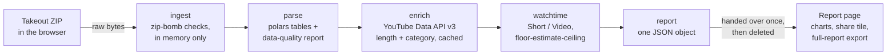

<div align="center">

# Reflex

**Your YouTube watch history, read back to you.**

Drop in your Google Takeout ZIP and get a shareable report: how much you really watch, what hour you really watch it, and who you turn out to be.

[](https://github.com/FasterFlash/reflex/actions/workflows/ci.yml)


**[Live demo](https://reflex-k8nt.onrender.com/)** &nbsp;·&nbsp; [How it works](#how-it-works) &nbsp;·&nbsp; [Privacy by design](#privacy-by-design) &nbsp;·&nbsp; [Run it locally](#run-it-locally)

</div>

<!-- Add a screenshot or GIF here: docs/hero.png (report hero + share card). It is the single biggest upgrade to this page. -->

---

## What you get

| | |
|---|---|
| **An alter ego** | A rule-based archetype (for example *The Night Scholar*) with the evidence that earned it. Not an AI guess: every claim is a count you can check. |
| **Honest hours** | Watch time as a range, floor ≤ estimate ≤ ceiling, because the last video before a long silence is a guess. The page says so instead of hiding it. |
| **Videos vs Shorts** | Split by time and by plays, with context rules for the 61–180 s videos that could be either. |
| **Your clock** | An hour-by-weekday matrix, sessions, and your longest uninterrupted Shorts scroll. |
| **Day by day** | One calendar, three views: a heatmap (day level), bars (month level) and a funnel (distribution). Streaks, busiest day, quiet stretches. |
| **Channels, categories, searches** | Top channels by time and by plays, a category donut, and a searches waffle with repeat searches. |
| **A share tile** | Pick a tagline (written from a cleaned fact sheet, never your raw history) and download it as Story, Post, or card only. |
| **A full report** | One self-contained HTML file with every chart, for you to keep. |

---

## How it works



| Stage | Module | What it does |
|---|---|---|
| Ingest | `ingest.py` | Opens the ZIP as hostile input: size, file-count and compression-ratio caps, no path escapes. Finds the history files by position, so it works with Google's localised folder names. |
| Parse | `parse.py` | Cleans the watch, search and subscription files, drops posts, ads and duplicates, and reports exactly what it dropped and why. |
| Enrich | `enrich.py` | Looks up each unique video once (about 170 API calls for 8,500 videos), caches the public facts in SQLite, retries removed videos after 30 days, and rotates across several API keys when one hits its quota. |
| Watch time | `watchtime.py` | A video was watched until the next event begins, capped at its length. Isolated events are credited at that person's own completion rate for that length. |
| Report | `report.py` | Counting and ranking only. No AI, no network. |
| Taglines | `taglines.py` | Optional Gemini call over a *cleaned fact sheet* (never raw history), with a rule-based fallback and per-client and daily limits. |
| Serve | `server.py` | FastAPI: upload, job status, one-shot report hand-over, feedback. Static files come from an explicit allow-list. |

---

## Privacy by design

Your watch history is personal, so the architecture is built to hold as little of it as possible.

- **The ZIP never touches the disk.** It is read in memory, parsed, and dropped.
- **The report is handed over once.** When your browser collects it, the server deletes the job. Jobs nobody collects expire after 15 minutes.
- **No accounts, no tracking.** The report lives in your browser's session storage.
- **The cache holds only public video facts** (length, category, channel), never who watched what.
- **Only a cleaned fact sheet reaches the AI**, and only for taglines.
- **Feedback stores a type, a message, a rating and an optional contact.** Never an IP address.
- **The code is public**, so none of this has to be taken on trust.

---

## Design decisions worth a look

- **Ranges, not fake precision.** About a third of total watch time rests on a guess about the last video before a long silence. Reflex reports a floor, an estimate and a ceiling, and shows all three.
- **Context decides Shorts.** A 61–180 s event is a Short if the video says `#shorts`, or if the events on both sides are Shorts in the same sitting. Checked against real data.
- **Hostile-input handling.** Uploads get size and compression-ratio limits and path-escape checks before any parsing happens.
- **Quota-aware enrichment.** Lookups are batched, cached and resumable, and a rotating fetcher moves to the next API key when one runs out (put keys in separate Google Cloud projects, since keys in one project share a quota).
- **Explicit static allow-list.** The server never mounts a directory, so `.env`, the backend and the takeouts folder are unreachable.
- **Honest failure modes.** When the lookup service is down, the user gets a clear message and nothing is saved.

---

## Run it locally

You need Python 3.11+ and, for enrichment, a [YouTube Data API v3 key](https://console.cloud.google.com/apis/library/youtube.googleapis.com).

```powershell
cd backend
python -m venv .venv
.venv\Scripts\Activate.ps1
pip install -e ".[dev]"
pytest
```

Create `backend\.env` (it is git-ignored):

```
YOUTUBE_API_KEY=your-key
YOUTUBE_API_KEY_1=optional-second-key-from-another-project
GEMINI_API_KEY_1=optional-for-ai-taglines
```

Start the site and open http://127.0.0.1:8000:

```powershell
reflex serve --web ..
```

Or use the command line directly:

```powershell
reflex inspect  "C:\path\to\takeout.zip"          # data-quality report
reflex enrich   "C:\path\to\takeout.zip" --dry-run  # what would be fetched, no key needed
reflex report   "C:\path\to\takeout.zip" --out data\report.json
```

To get your own data: [takeout.google.com](https://takeout.google.com), deselect everything, tick **YouTube and YouTube Music**, set history to **JSON**, and export. The site has a step-by-step guide with clips.

### Docker

```bash
docker build -t reflex .
docker run -p 7860:7860 -e YOUTUBE_API_KEY=your-key reflex
```

The container listens on `$PORT` (default 7860) and runs as a non-root user.

---

## Tech

Python · polars · FastAPI · uvicorn · SQLite · YouTube Data API v3 · Gemini (taglines only) · vanilla HTML/CSS/JS with canvas effects · pytest · Docker · GitHub Actions

## Tests and CI

195 tests cover ingest safety, parsing, watch-time maths, the report, the server and feedback. GitHub Actions runs them on Python 3.11, 3.12 and 3.13, then builds the Docker image and smoke-tests it on every push.

## Honest limits

- Hours are estimates. Google's export has no watch durations, only start times.
- Music and removed or private videos have no length, so they count as "unknown" and not as Shorts or Videos.
- The free demo host sleeps when idle (first load takes about a minute) and keeps nothing between restarts.
- Searches are grouped by normalised text, not meaning.

---

<div align="center">

Built by [Tarun Challa](https://github.com/FasterFlash) · IIIT Nagpur

</div>
